<h1 align="center">Caimack</h1>

<p align="center"><strong>Your music library, streamed from your own server.</strong></p>

<p align="center">Self-hosted · Private · Web and Android · Recommendations that never leave the box</p>

<p align="center">
  
  
  
  
  
  
</p>

<p align="center">
  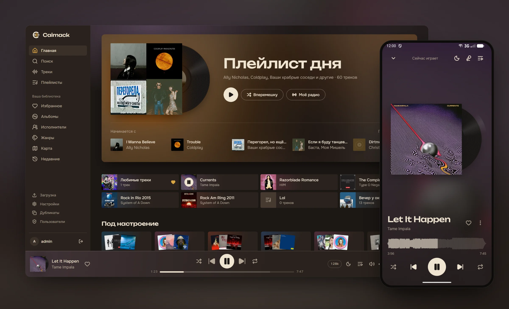
</p>

Caimack turns a personal music collection into a private streaming service. Point it at the folder
your MP3 and FLAC files already live in, or upload them, invite the people you trust, and listen from a browser or the Android app. The
server learns what you like from what you actually play, and that data stays on your hardware.

## Highlights

- **Recommendations from your own listening.** A daily mix, personal radio and "for you" shelves
  are built from real plays, skips and favourites. Every track is analysed by a local CLAP audio
  model, so radio can follow how songs *sound*, not only who made them.
- **Radio for a mood.** Workout, party, chill, sleep, happy, sad: one tap starts a radio of your
  own library that fits the mood and your taste. Moods are text prompts matched against the same
  CLAP audio embeddings, so no tags or manual sorting are needed.
- **Monthly recap.** For the first week of every month, a story-style recap of the previous one:
  hours of music, artist and track of the month, the busiest day, when you listen, the mood the
  month sounded like and the one track that sums it up.
- **A map of your library.** Every track becomes a dot placed by how it sounds, so neighbours
  sound alike. Pan and zoom through it, light up a genre, or draw around an area and play it as
  one smooth path from sound to sound.
- **Smart transitions.** Albums played in order join without a gap, silence between unrelated
  tracks is cut, and a crossfade stretches into a track's own fade-out and lands on the beat.
  Every track is analysed on the server for where its sound starts and ends and for its tempo.
- **A record that hears the music.** In the full-screen player a ring of spectrum bars plays
  around the spinning vinyl and the backdrop breathes with the bass; the seek bar is the track's
  own waveform, marked where the next track will come in.
- **Coloured by what's playing.** The player and the page around it take on the colour of the
  cover that's playing, and cards, tiles and moods carry the tones of their own covers. Five
  palettes, each in dark and light; the cover colour can be switched off.
- **Lean back.** Leave the app alone while music plays and it turns into a screensaver: a big
  spinning record, the clock and the current lyric line, drifting slowly so nothing burns in.
- **Synced lyrics.** Lyrics follow the song line by line in the full-screen player; they're
  fetched from LRCLIB automatically and can be edited by hand.
- **Steady playback on bad networks.** Adaptive HLS moves between 64 kbps, 128 kbps and the
  original file, while the browser keeps a bounded stream cache for patchy coverage.
- **One session across devices.** Start a track on the phone, see it on the desktop and pick it
  up with "Continue here", position included.
- **A full player.** Editable queue with drag and drop, "keep going with similar tracks",
  shuffle, repeat, crossfade, an equalizer, a sleep timer that fades out, media keys, lock-screen
  controls and keyboard shortcuts (press `?`).
- **A native Android client.** Kotlin, Jetpack Compose and Media3, with offline downloads,
  Android Auto and a quick-settings tile that starts your radio in one tap.
- **Your existing music folder.** Mount it read-only and Caimack picks up new, changed and moved
  files on its own, with the album art from the folder. Nothing in it is ever modified or deleted.
- **A library you control.** Drag in files or whole folders, edit tags and artwork, build
  playlists, flip through albums like records in a crate, browse by genre and download the
  original files whenever you want. Share what you play as a story card. Duplicates are
  found by sound, not by file name: keep the best copy and its likes, playlists and history move
  onto it.
- **Simple private hosting.** Application, database and HTTPS proxy come up from a single
  Docker Compose file, with no external account required.

## A look around

<p align="center">
  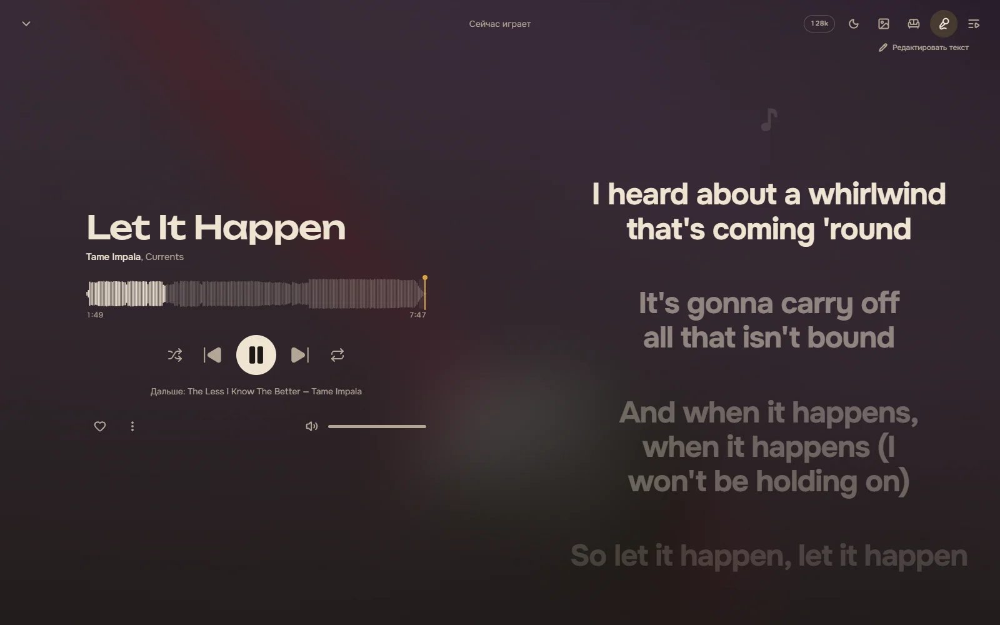
</p>

<p align="center"><sub>The full-screen player builds its backdrop from the cover art of whatever is
playing; synced lyrics highlight the current line.</sub></p>

<table>
  <tr>
    <td width="50%">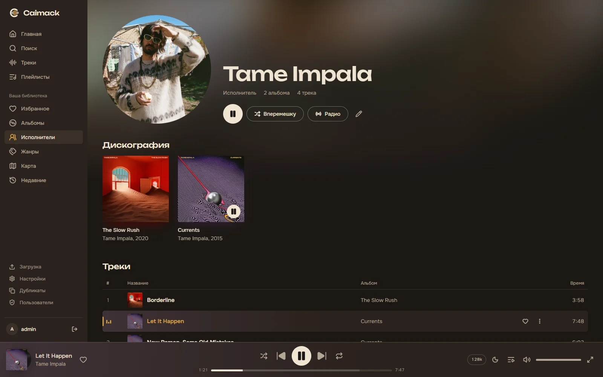</td>
    <td width="50%">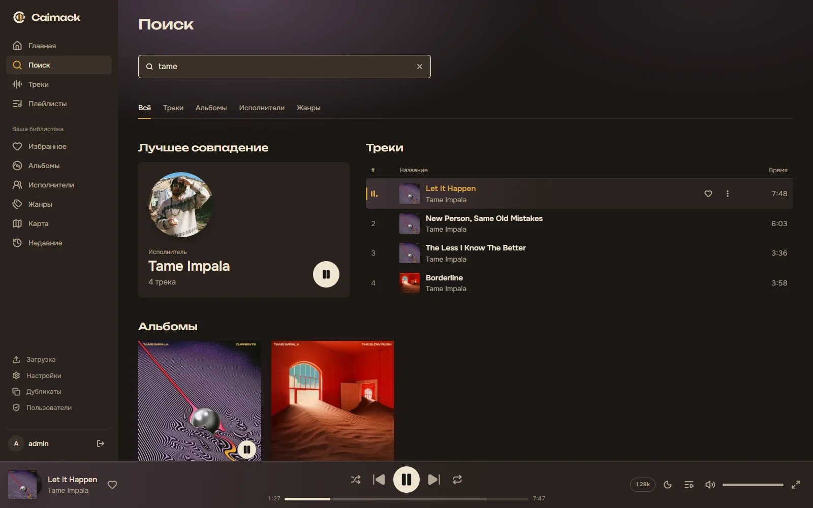</td>
  </tr>
  <tr>
    <td align="center"><sub>Artist pages pick their colours up from the artist photo</sub></td>
    <td align="center"><sub>Search across tracks, albums, artists and genres</sub></td>
  </tr>
  <tr>
    <td width="50%">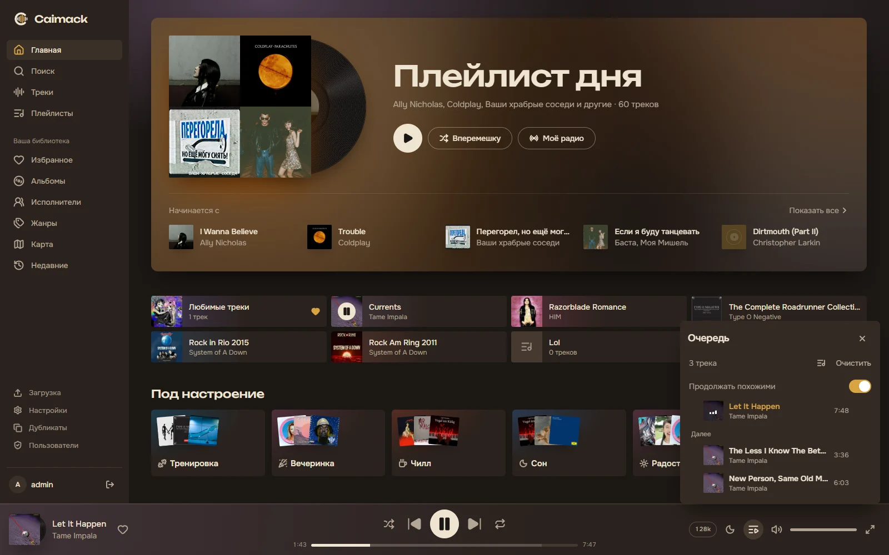</td>
    <td width="50%">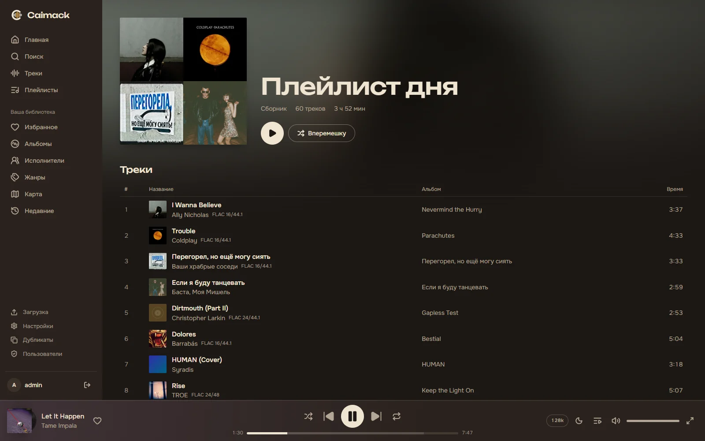</td>
  </tr>
  <tr>
    <td align="center"><sub>The queue, with "keep going with similar tracks"</sub></td>
    <td align="center"><sub>A new playlist of the day every morning</sub></td>
  </tr>
</table>

<p align="center">
  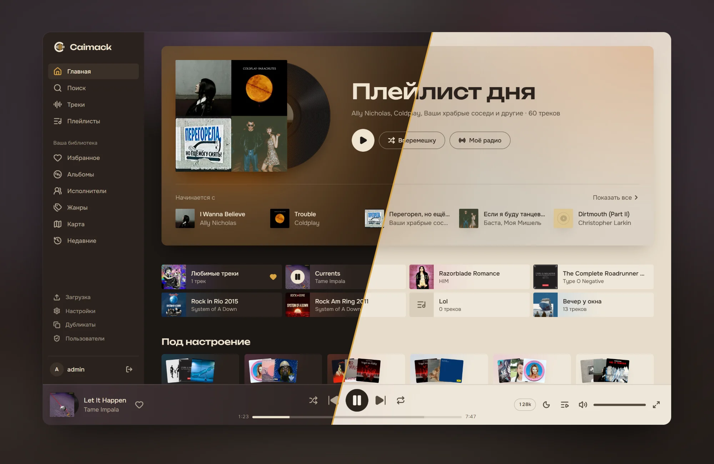
</p>

<p align="center"><sub>Dark and light themes, following the system by default.</sub></p>

### On the phone

The web app is a PWA with its own mobile layout, and there is a native Android client as well.

<p align="center">
  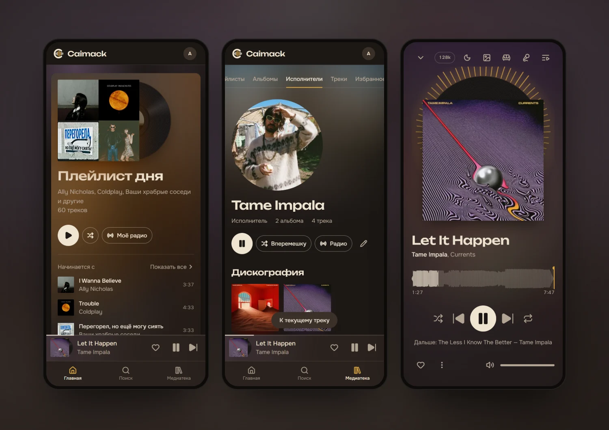
</p>

<p align="center">
  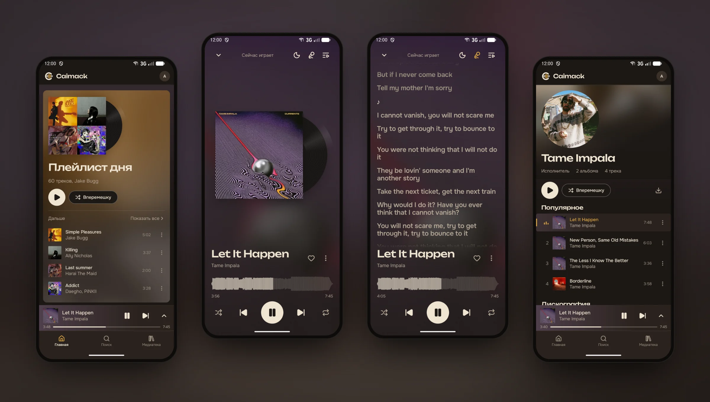
</p>

<details>
<summary>More screens</summary>

<br>

| | |
| --- | --- |
| 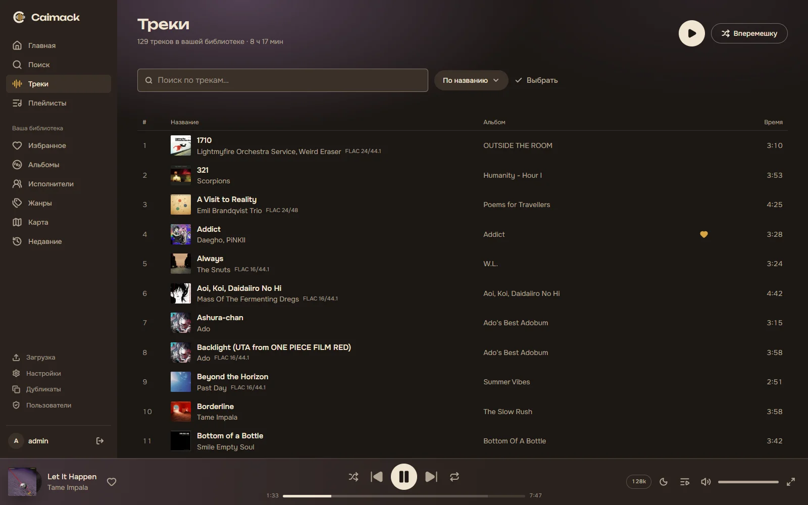 | 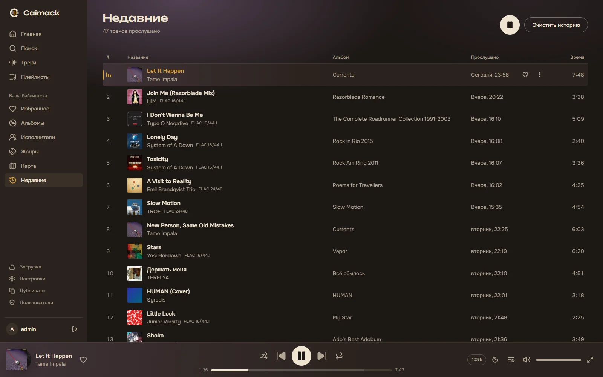 |
| All tracks, with sorting and bulk selection | Listening history |
| 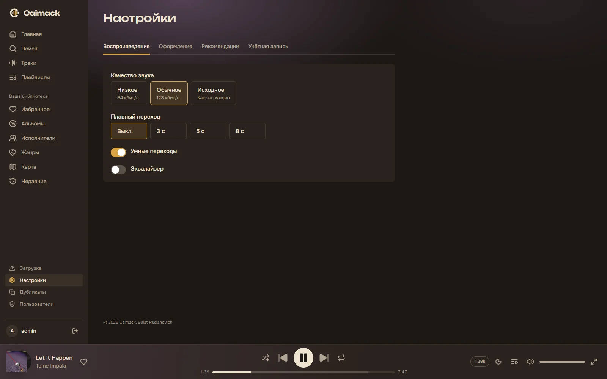 | |
| Stream quality, crossfade and equalizer | |

</details>

## How it fits together

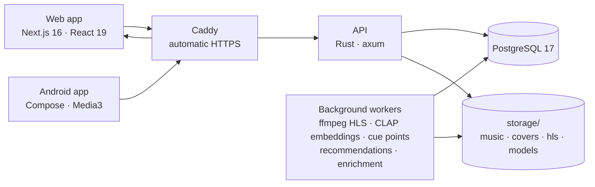

| Part | What it does |
| --- | --- |
| `backend/` | Rust API (axum, sqlx). Background workers transcode uploads to HLS with ffmpeg, analyse each track once for its CLAP audio embedding (ONNX Runtime), cue points and tempo, and look up lyrics (LRCLIB) and artist photos (Deezer). Recommendations, the library map and duplicate detection run in memory over a snapshot of the embeddings. |
| `frontend/` | Next.js app with TanStack Query and hls.js. A service worker caches the shell, artwork and stream segments. |
| `android/` | Kotlin client using Jetpack Compose and Media3: background playback, downloads, Android Auto and a quick-settings radio tile. |
| `db/` | The database schema as numbered SQL migrations, applied by `caimack migrate` (the `migrate` service in Compose); the server only checks that the schema is current. See [db/README.md](db/README.md). |
| `deploy/` | Caddyfile for the reverse proxy. |

## Quick start

```bash
git clone https://github.com/BulatRuslanovich/music-streaming.git
cd music-streaming
./setup.sh
```

The script asks for the domain, the folder with your music and the admin username, writes `.env`
with fresh secrets and starts everything from the prebuilt images on `ghcr.io`. It prints the admin
password at the end. `./setup.sh --build` builds the images on the server instead, and
`./setup.sh --help` shows the options for running it without questions.

To set it up by hand, copy `.env.example` to `.env` and fill in:

```env
POSTGRES_PASSWORD=   # openssl rand -hex 32 (it goes into a URL, so no special characters)
JWT_SIGNING_KEY=     # openssl rand -base64 48
OWNER_PASSWORD=      # password for the first admin account
PUBLIC_DOMAIN=       # domain for the automatic HTTPS certificate
MUSIC_LIBRARY_PATH=  # optional: a folder with your music, mounted read-only (default ./library)
COMPOSE_FILE=docker-compose.yml:docker-compose.images.yml   # use the prebuilt images; leave out to build
```

Then run `docker compose up -d`. To update, run `docker compose pull && docker compose up -d`;
`CAIMACK_VERSION` pins a release instead of `latest`.

The music folder is rescanned every hour (`LIBRARY_SCAN_INTERVAL_MINUTES`, `0` for manual only)
and from the Upload page. A file that disappears stays in the library for 30 days, so a drive that
is briefly disconnected costs no likes or history; a moved file keeps its track.

The first start downloads the CLAP audio model (about 280 MB, checked against a pinned SHA-256)
into `storage/models`. To export it yourself instead, which takes PyTorch and several GB of RAM,
run `make model` on a workstation and copy `storage/models/` to the server before the first start.

Then open `https://<PUBLIC_DOMAIN>` and sign in as the owner: the music folder is scanned on its
own, and more music can be dropped onto the Upload page. Invite people from the Users page: each
invitation is a one-time link that lets them pick a username and a password.

## Development

You'll need Rust 1.94+, ffmpeg on `PATH`, Node.js, Docker and, for the Android client, the Android SDK.

```bash
cp backend/.env.example backend/.env   # then set JWT_SIGNING_KEY and OWNER_PASSWORD
make backend
make frontend
```

`make help` lists everything. The one that matters before a push is `make check`: formatting,
lint and both test suites, the same as CI. SQL in the backend is checked against the database at
compile time; after changing a query, run `make sqlx` so builds without a database (CI,
Docker) see it.

To work on the frontend against another backend, point the dev proxy at it:

```bash
cd frontend && BACKEND_INTERNAL_URL=https://music.example.com npm run dev
```

### Android

```bash
make apk   # android/app/build/outputs/apk/release/app-release.apk
```

A release build is signed with your own key, the same one every time: Android installs an update
only over an app signed with the same key. Create one once and keep it safe:

```bash
keytool -genkeypair -v -keystore ~/caimack-release.jks -alias caimack \
  -keyalg RSA -keysize 4096 -validity 10000
```

Then point the build at it in `android/keystore.properties` (ignored by git):

```properties
storeFile=/home/me/caimack-release.jks
storePassword=...
keyAlias=caimack
keyPassword=...
```


## License

MIT — see [LICENSE](LICENSE).
